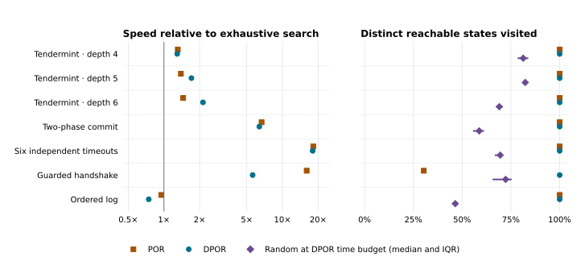

# Bounded state coverage and performance in Quint

DPOR reached every state that exhaustive search found in all seven workloads. At depth six on Tendermint, it cut median time from 6.47 s to 3.03 s. TypeScript random sampling visited a median of 433 of the 627 states in 3.03 s.

The [larger-state-space benchmarks](LARGE.md) cover seven-validator Tendermint, eight-manager two-phase commit, twelve independent timeouts and a depth-twelve ordered log. They include fixed-work and fixed-time comparisons against a state-caching breadth-first search and seeded random sampling. The [production BFS measurements](BFS.md) compare the native Rust and TypeScript strategies, their memory use and replay behavior.

The Tendermint cases use the full upstream `Next` relation with four correct validators, one valid value and round zero. The independent-timeout case uses seven validators and restricts the scheduler to the six non-proposers. Two-phase commit uses the upstream three-resource-manager instance. The guarded handshake and ordered log isolate two different dependency patterns.



## Systematic exploration

Times are medians in milliseconds for the TypeScript evaluator. State counts are distinct, complete model states reached from initialization through the depth bound. The harness checks set equality for the sleep-set searches and checks that every sampled or reduced state belongs to the exhaustive reference.

| Model and depth | Exhaustive states | POR states | DPOR states | Exhaustive ms | POR ms | DPOR ms | DPOR speedup |
| --- | ---: | ---: | ---: | ---: | ---: | ---: | ---: |
| Tendermint, d4 | 91 | 91 | 91 | 253 | 193 | 195 | 1.29× |
| Tendermint, d5 | 190 | 190 | 190 | 1,025 | 738 | 601 | 1.71× |
| Tendermint, d6 | 627 | 627 | 627 | 6,469 | 4,455 | 3,031 | 2.13× |
| Two-phase commit, d5 | 171 | 171 | 171 | 393 | 58.9 | 61.6 | 6.38× |
| Six independent timeouts, d6 | 64 | 64 | 64 | 633 | 34.8 | 35.2 | 17.97× |
| Guarded handshake, d6 | 56 | 17 | 56 | 10.9 | 0.7 | 1.9 | 5.60× |
| Ordered log, d6 | 1093 | 1093 | 1093 | 17.8 | 18.8 | 23.9 | 0.74× |

The six timeouts can occur in any order. DPOR explored one complete schedule and retained every one of the 64 reachable subsets. On the ordered log, distinct appends change the final list. DPOR checked 363 candidate swaps, explored all 729 schedules and took 34% longer than exhaustive DFS.

Guarded-command POR preserves the specified observations. It visited 17 of 56 handshake states, satisfied the phase invariant and reached the acknowledgement. The omitted states differ in background counters. The general sleep-set searches retained every concrete state on their tested instances.

E, P and D denote exhaustive, POR and DPOR.

| Model and depth | Schedules E / P / D | Action evaluations E / P / D | DPOR diamond checks |
| --- | ---: | ---: | ---: |
| Tendermint, d4 | 228 / 164 / 117 | 5,009 / 4,105 / 3,999 | 119 |
| Tendermint, d5 | 1,194 / 837 / 517 | 22,481 / 16,616 / 13,317 | 290 |
| Tendermint, d6 | 10,428 / 7,977 / 3,869 | 127,385 / 90,460 / 60,791 | 1,443 |
| Two-phase commit, d5 | 2,382 / 165 / 165 | 12,377 / 2,501 / 2,629 | 64 |
| Six independent timeouts, d6 | 720 / 1 / 1 | 7,423 / 451 / 451 | 0 |
| Guarded handshake, d6 | 470 / 16 / 12 | 1,205 / 69 / 216 | 0 |
| Ordered log, d6 | 729 / 729 / 729 | 1,093 / 1,093 / 1,819 | 363 |

Evaluations include disabled alternatives and speculative replays. Diamond checks count attempted concrete two-order comparisons. A completed schedule counts a maximal or depth-limited execution. Several schedules can end in the same state.

## Random sampling at comparable wall time

The fixed budget is 100 traces per seed. The matched budget is a separately calibrated number of random traces for each workload, targeting its median DPOR runtime. Both measured times are shown. State counts and percentages are medians across 20 seeds. The IQR spans the 25th and 75th percentiles of coverage.

| Model and depth | 100 traces, states (%) | Matched traces | Random ms | DPOR ms | Matched states (%) | Matched coverage IQR |
| --- | ---: | ---: | ---: | ---: | ---: | ---: |
| Tendermint, d4 | 72.5 (79.7%) | 105 | 178 | 195 | 74 (81.3%) | 78.8%–83.5% |
| Tendermint, d5 | 123 (64.7%) | 258 | 584 | 601 | 156.5 (82.4%) | 81.6%–82.9% |
| Tendermint, d6 | 190.5 (30.4%) | 1,133 | 3,027 | 3,031 | 433 (69.1%) | 67.9%–70.4% |
| Two-phase commit, d5 | 100.5 (58.8%) | 100 | 62.9 | 61.6 | 100.5 (58.8%) | 56.0%–60.8% |
| Six independent timeouts, d6 | 64 (100.0%) | 17 | 35.3 | 35.2 | 44.5 (69.5%) | 67.2%–70.3% |
| Guarded handshake, d6 | 55 (98.2%) | 16 | 1.8 | 1.9 | 40.5 (72.3%) | 66.1%–75.0% |
| Ordered log, d6 | 273 (25.0%) | 271 | 24.4 | 23.9 | 508 (46.5%) | 46.3%–46.7% |

## Reaching a particular state

Every systematic search satisfied the model invariant and reached its target. To measure detection, the harness reruns each evaluator with the target negated as an invariant. The random columns count seed campaigns that found that counterexample within the stated number of traces. These targets describe allowed states and provide known ground truth for the measurement.

| Model and depth | Reachability target | Random @ 10 | Random @ 100 | Random @ matched | First violation depth E / P / D |
| --- | ---: | ---: | ---: | ---: | ---: |
| Tendermint, d4 | p2 precommits | 7/20 | 20/20 | 20/20 | 4 / 4 / 4 |
| Tendermint, d5 | p2 precommits | 19/20 | 20/20 | 20/20 | 5 / 5 / 5 |
| Tendermint, d6 | p2 precommits | 20/20 | 20/20 | 20/20 | 6 / 6 / 6 |
| Two-phase commit, d5 | TM recorded two prepares | 1/20 | 15/20 | 15/20 | 5 / 5 / 5 |
| Six independent timeouts, d6 | All six followers timed out | 20/20 | 20/20 | 20/20 | 6 / 6 / 6 |
| Guarded handshake, d6 | Acknowledgement | 20/20 | 20/20 | 20/20 | 6 / 2 / 6 |
| Ordered log, d6 | Six successive 2s | 3/20 | 5/20 | 11/20 | 6 / 6 / 6 |

A separate transient `phaseOrder` check uses the three-follower timeout model at depth one. All systematic strategies found a violating intermediate state. Random sampling found it on the first trace in 3/20 campaigns and within ten traces in 20/20.

## Default Rust sampler

For full Tendermint at depth five, the single-worker Rust sampler reached a median of 124.5 / 190 states in 100 traces and hit the quorum target in 20/20 campaigns. TypeScript reached 123 / 190 states and hit it in 20/20. These coverage runs collected all 100 traces from Rust and checked each state against the same exhaustive reference.

At the end-to-end DPOR budget, Rust sampled 2,873 traces in 2,802 ms, versus 2,711 ms for DPOR. The Rust median was 190 / 190 states (100.0%), with full coverage in 14/20 campaigns. At exactly 1,000 traces the Rust median was 184 / 190.

The following timings launch a fresh `quint run` process each time. Both random backends run the fixed 1,000-trace workload with one worker. An additional Rust run uses the matched budget. The systematic strategies run to completion at depth five. All use the same invariant and witness. These numbers include CLI startup, parsing, typechecking and backend transport. The larger, untimed Rust coverage exports continue each seeded campaign in bounded batches using the next trace’s recorded RNG counter. The harness checks the distinct-state count at 100 traces against a standalone run for every seed. A separate audit of one 321-trace campaign found the same 1,926 state occurrences with and without batching.

| Mode | Work per invocation | Median end-to-end ms | IQR ms |
| --- | ---: | ---: | ---: |
| Random, TypeScript | 1,000 traces | 4,483 | 4,339–4,503 |
| Random, Rust (one worker) | 1,000 traces | 2,127 | 2,068–2,157 |
| Random, Rust (one worker) | 2,873 traces | 2,802 | 2,694–2,901 |
| Exhaustive | Complete depth 5 | 3,141 | 3,058–3,160 |
| POR | Complete depth 5 | 2,844 | 2,785–2,928 |
| DPOR | Complete depth 5 | 2,711 | 2,698–2,725 |

## Measurement and reproduction

- Measured on 22 November 2026 on Linux 6.18.57, x64, INTEL(R) XEON(R) PLATINUM 8573C, Node v24.22.3. Timings are specific to this host.
- The main tables time the actual TypeScript execution paths with a freshly constructed evaluator per search, using an already parsed and typechecked model. They include evaluator construction, action compilation, evaluation and normal trace bookkeeping. Each case has warmups and seven rounds with rotating strategy order. Short runs are batched. The fresh-process comparison uses one warmup and five rounds per mode.
- Coverage is collected in separate untimed runs. States include every modeled variable, including Tendermint’s `fired_action`. The observer uses Quint’s normalized runtime values and structural equality. The coverage observer runs outside the model, so only the specified invariants and witnesses guide the reduction. Random coverage collects every trace prefix, including initialization. Seeds are widely spaced 64-bit counters, and the matched sample count is calibrated before collecting coverage.
- This experiment measures bounded state reachability on finite instances. Schedule counts, full-state coverage and finding one target answer different questions. The per-seed outcomes, individual timings and evaluation counts are available in [results.json](results.json).

From the repository root, build the TypeScript simulator and run the benchmark.

```sh
(cd quint && npm ci && npm run compile)
node quint/benchmarks/exploration/bench.js --output measurements.json
```

To include the Rust comparison, use the evaluator built from this checkout. The launcher's cache location below is isolated for the benchmark.

```sh
cargo build --release --locked --manifest-path evaluator/Cargo.toml
benchmark_config=$(mktemp -d)
mkdir -p "$benchmark_config/rust-evaluator-v0.7.1"
cp evaluator/target/release/quint_evaluator "$benchmark_config/rust-evaluator-v0.7.1/"
QUINT_HOME="$benchmark_config" node quint/benchmarks/exploration/bench.js --rust --output measurements.json
```

Use `--rust-only` to repeat just the Rust comparison and its fresh-process baselines. Pass case names such as `tendermint-5 ordered-log` to select individual workloads. To regenerate the figure from the checked-in data, run `python quint/benchmarks/exploration/plot.py` with Matplotlib installed.
